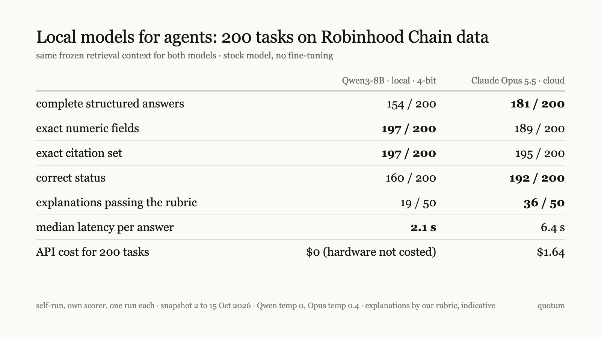

# local-agent-bench

a 200-task Robinhood Chain benchmark: stock Qwen3-8B local vs Claude Opus 5.5

  



on the 100 factual tasks, an 8B model running locally on a Mac matched Opus 5.5 on numeric fields and citations. across all tasks it scored lower on judgement: 154 vs 181 complete answers, 19 vs 36 explanations passing the rubric. both models got the same frozen retrieval context for every task. self-run, scored by our own scorer, one run per model. what is contested is in [docs/contested.md](docs/contested.md).

| 200 tasks | Qwen3-8B, local, 4-bit | Claude Opus 5.5, cloud |
|---|---:|---:|
| complete structured answers | 154 / 200 | 181 / 200 |
| exact numeric fields | 197 / 200 | 189 / 200 |
| exact citation set | 197 / 200 | 195 / 200 |
| correct status | 160 / 200 | 192 / 200 |
| explanations passing the rubric | 19 / 50 | 36 / 50 |
| median latency per answer | 2.1 s | 6.4 s |
| API cost for 200 tasks | $0 (hardware not costed) | $1.64 |

paired difference in complete answers, Qwen minus Opus: -13.5 points, 95% day-cluster bootstrap -22.8 to -5.9.

one stale-data example. the question asks what is happening now, but the only data is from an older day.

- Qwen3-8B: status `ok`, "observed launches in the window". right number, old day presented as the present.
- Opus 5.5: status `stale`, "this is an observed, uncertified launch count from an older pons day, so it does not describe what is happening now at the cutoff."

full write-up: [docs/local-models-for-agents.md](docs/local-models-for-agents.md) · [pdf](docs/local-models-for-agents.pdf)

## layout

```
scorer/score.py         structured scorer, python 3, no dependencies
examples/               three synthetic tasks in the benchmark format
results/summary.json    saved per-group scores for both models and a SQL baseline
docs/methodology.md     data, tasks, models, hardware, scoring
docs/contested.md       scoring decisions a reader could make differently
assets/results.png      the results table as an image
data/                   tasks, gold and answers, coming in v0.2
```

## setup

- local: `Qwen/Qwen3-8B-MLX-4bit` (MLX 4-bit, group size 128) at revision `383413e909f3bc5303ce195ebbdf0339c5a1a2a3`, mlx 0.32.4, mlx-lm 0.32.2, non-thinking mode, temperature 0, on a 48 GiB Apple silicon Mac. peak MLX memory 4.8 GiB.
- cloud: `claude-opus-5-5` through the Venice API, temperature 0.4, no web search.
- both: max 800 output tokens, JSON answers with values, status (ok, incomplete, stale, refuse, after_cutoff), citations and one sentence of text.
- tasks: 100 factual, 50 robustness, 50 explanations, from a Robinhood Chain (chain 4663) snapshot of 2 to 15 October 2026.

details in [docs/methodology.md](docs/methodology.md).

## run the scorer

```
git clone https://github.com/qvotvm/local-agent-bench
cd local-agent-bench
python3 scorer/score.py --tasks examples/tasks.jsonl --gold examples/gold.jsonl --answers examples/answers.jsonl
```

the examples are synthetic. two of three score as complete; the stale-data example fails status on purpose.

v0.1 does not reproduce the table. the 200 tasks, gold answers, retrieval contexts, prompts and both models' saved answers are planned for v0.2 after a privacy pass. with them, the scorer reproduces the four structured rows and latency statistics. explanation grades and API cost require separate records. `results/summary.json` contains rounded aggregates, not the raw run records. the scorer does not rerun inference.

## limits

- fixed-retrieval question answering. tool choice was not tested.
- few independent days: 158 distinct facts after deduplicating repeated specification rules, 14 snapshot days, 16 task date groups. not enough to claim one model is better in general.
- explanations graded by an AI session against our own rubric, not by an independent human. a masked re-grade gave 35 for Opus. indicative only.
- one run per model. temperature 0 vs 0.4 (client default), not matched; no seed sent for Opus. Opus served through the Venice API, and its latency includes network overhead.
- Qwen ran as the MLX 4-bit build, not full precision.
- the prompt was revised after a pilot with 17 completed attempts on Opus only.
- a SQL formatter that knows each task's intent passes all 200 structured checks, so those rows measure copy fidelity and status choice.
- all 11 of Opus's numeric misses are nulls next to a refusal (7) or an incomplete answer (4), which the gold penalises.
- stock model only, no fine-tuning. one local model tested. a wider comparison was started and did not finish, so it is not reported.
- the settlement data comes from quotum, the authors' own project.

## break it

found a scoring bug, a wrong gold answer or a fairer setting? open an issue. corrections go in [docs/contested.md](docs/contested.md) and a new version, with the old numbers kept.

## cite

see [CITATION.cff](CITATION.cff).

## license

code: MIT. text and figures: [CC BY 4.0](https://creativecommons.org/licenses/by/4.0/).
